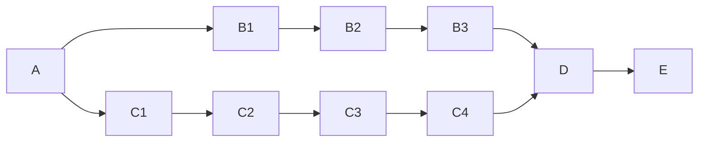

# 口语 coach 首轮试用（虚构示例） · 项目总览

> 固定文件是带时间的快照。打开文件不会检查执行器；刷新时须由 AI 核验。

计划 v1 · 修订 1 · 保存时间 2026-10-22T22:47:39+08:00 · 时区 Asia/Hong_Kong（时间带 UTC 偏移）

**目标：** 首轮试用者用首批课程完成一次完整口语练习

**本次交付：** 约定的最小流程、首批素材、接入与完整流程验证

| 当前范围已验证完成度 | 剩余执行时间 | 预计交付时间 |
|---|---|---|
| 30% | 100—160 分钟，粗估 | 只提供执行区间，不承诺具体时刻 |

范围：fixed。完成度只计通过检查且证据仍有效的末级里程碑。权重是计划估计，不是客观工作量测量。

## 需要你关注

暂无需要你回答或操作的事项。AI 继续推进已授权工作。

## 全局交付与依赖

| 部分 | 已验证权重 / 总权重 | 部分完成度 | 本部分剩余执行（不含外部依赖等待） |
|---|---:|---:|---|
| A 交付与接口约定 | 10 / 10 | 100% | 0—0 分钟 |
| B 最小练习流程 | 10 / 30 | 33.3% | 60—90 分钟 |
| C 首批课程素材 | 10 / 25 | 40% | 30—45 分钟 |
| D 接入 | 0 / 15 | 0% | 20—30 分钟 |
| E 整体验证与交付 | 0 / 20 | 0% | 20—40 分钟 |

| 编号 · 交付物 | 主支线 / 负责人 | 状态 | 依赖 | 剩余执行时间 | 下一步 / 解除条件 |
|---|---|---|---|---|---|
| A · 首轮范围与素材接口 | 主线 / 示例执行者 | 已验证 | 无 | 0—0 分钟 | 已取得本示例的完成资格 |
| B1 · 基础界面 | 主线 / 示例执行者 | 已验证 | A | 0—0 分钟 | 已取得本示例的完成资格 |
| B2 · 录音与反馈 | 主线 / 示例执行者 | 未开始 | B1 | 45—65 分钟 | 完成并验证该交付 |
| B3 · 流程衔接 | 主线 / 示例执行者 | 未开始 | B2 | 15—25 分钟 | 完成并验证该交付 |
| C1 · 主题与级别约定 | 素材支线 / 示例执行者 | 已验证 | A | 0—0 分钟 | 已取得本示例的完成资格 |
| C2 · 首课样例检查 | 素材支线 / 示例执行者 | 已验证 | C1 | 0—0 分钟 | 已取得本示例的完成资格 |
| C3 · 剩余首批内容 | 素材支线 / 示例执行者 | 未开始 | C2 | 25—35 分钟 | 完成并验证该交付 |
| C4 · 整批格式检查与接入条件 | 素材支线 / 示例执行者 | 未开始 | C3 | 5—10 分钟 | 完成并验证该交付 |
| D · 主线读取素材并衔接练习 | 主线 / 示例执行者 | 未开始 | B3, C4 | 20—30 分钟 | 完成并验证该交付 |
| E · 完整练习流程通过检查并交付试用 | 主线 / 示例执行者 | 未开始 | D | 20—40 分钟 | 完成并验证该交付 |

图不能显示时，上表的依赖编号仍完整保留。图中可并行不代表已启动多个执行者。

依赖最长链（未计资源争用）：B2 → B3 → D → E

实际排程容量：2。依据：本虚构案例假设存在两个已授权且可并行承担任务的执行者；真实项目默认一个。

排程按依赖与现有任务顺序做资源受限粗估，假设执行者可互换；共享资源冲突需记录成依赖或按一个执行者估算。不是最优排程或概率保证。

### 预计时间泳道

从本次快照起的剩余分钟，上限情形；不含等待。

| 任务 | 执行槽位 | 开始分钟 | 结束分钟 |
|---|---:|---:|---:|
| B2 | 1 | 0 | 65 |
| B3 | 1 | 65 | 90 |
| C3 | 2 | 0 | 35 |
| C4 | 2 | 35 | 45 |
| D | 1 | 90 | 120 |
| E | 1 | 120 | 160 |

## 当前执行与下一步

截至 未取得核验时间 记录为待核实；快照不代表当前运行（来源：虚构示例，没有真实运行中的产品任务）

可开始或继续：B2、C3

**下一步：** 虚构案例：完成 B2 录音与反馈、C3 剩余素材；二者通过后汇合接入

## 完成标准与证据

- 首批素材通过内容与格式检查
- 主线正确加载素材并衔接必要练习步骤
- 完整用户流程通过验证并可供试用

以下是已记录的验证证据；指纹检查只证明文件未变化，AI 仍须判断检查是否充分。

- A · `example-verification.txt` · 读取明确标为虚构的展示回执 · 2026-10-22T12:00:00+00:00 · 有效
- B1 · `example-verification.txt` · 读取明确标为虚构的展示回执 · 2026-10-22T12:00:00+00:00 · 有效
**B2 关键未知：** 反馈流程的实际效果尚待验证

- C1 · `example-verification.txt` · 读取明确标为虚构的展示回执 · 2026-10-22T12:00:00+00:00 · 有效
- C2 · `example-verification.txt` · 读取明确标为虚构的展示回执 · 2026-10-22T12:00:00+00:00 · 有效

## 范围与授权

本轮暂不包含：扩大课程覆盖；新增付费或公开发布

已授权：仅展示和计算虚构案例

投入与授权边界：不得据此操作真实口语 coach 项目

## 最近变化与交接

- 2026-10-22T14:47:39+00:00 · r1 · init · 由现有需求建立交付约定 · 完成度 30%

**交接说明：**
- 此目录为虚构计算与展示，不是用户真实项目状态。

**已尝试失败方法：**
- 暂无记录

**恢复所需资源：**
- example-verification.txt：明确标为虚构的输入回执

权威记录：`project-state.json`。最近备份：`project-state.previous.json`；历史：`history/`；待合并报告：`reports/`。

恢复时先核对项目身份、协调者代次、真实成果和执行器。普通打开文件不产生后台执行。
